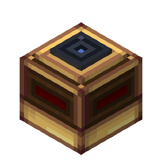
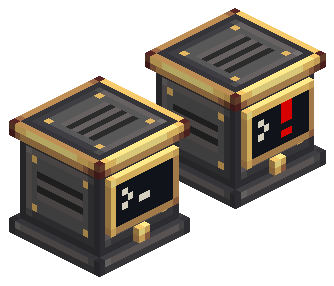
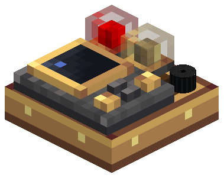
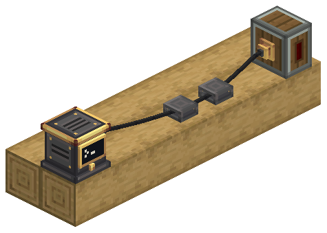
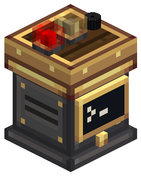

# Aeronautics: Fly by Instruments

Aeronautics: Fly by Instruments adds avionics blocks for Create Aeronautics ships. Radar Altimeters and Terrain Scanners measure the world around a craft and expose readings through redstone and CC:Tweaked. The Avionics Computer turns sensor readings into GPWS alerts, while a Modular Table combines warning lamps, buzzers and an FMS. Attitude instruments add an experimental artificial horizon.

**Documentation reflects Aeronautics: Fly by Instruments 0.4.0-beta.2** · Minecraft 1.21.1 · NeoForge.

## Documentation

- [Install and use](player/)
- [Sensors](player/sensors): Radar Altimeter, Terrain Scanner and Advanced Terrain Scanner
- [Avionics Computer and GPWS](player/avionics-computer)
- [Modular Table](player/modular-table): lamps, buzzer, FMS and Attitude Indicator
- [Avionics Wire](player/avionics-network): connectors, supports and the Wiring View
- [Attitude instruments](player/attitude-instruments): Attitude Reference Unit and Attitude Indicator
- [Ponder tutorials](player/ponder)
- [Configuration](player/configuration)
- [Computer Craft](player/computer-craft)

The Network Bridge, Attitude Reference Unit and Attitude Indicator are Experimental and creative-only. The other avionics blocks can be crafted. Computer Craft contains all CC:Tweaked and Lua instructions in one place.

| | |
| --- | --- |
|  |  |
|  |  |

## Changelog

[View release notes](./changelog)
