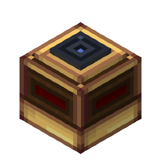
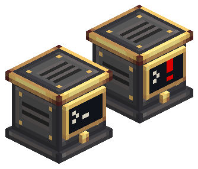
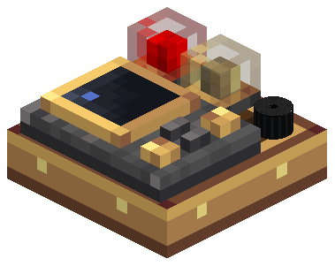
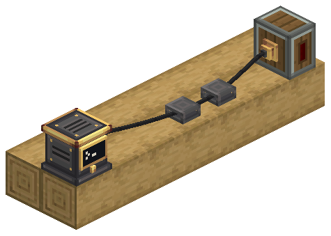
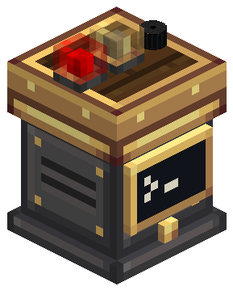

# Aeronautics: Fly by Instruments

Aeronautics: Fly by Instruments adiciona blocos aviônicos para naves do Create Aeronautics. Radar Altimeters e Terrain Scanners medem o mundo ao redor da aeronave e disponibilizam leituras por redstone e CC:Tweaked. O Avionics Computer transforma as leituras em alertas GPWS, enquanto a Modular Table combina lâmpadas, buzzers e um FMS. Os instrumentos de atitude acrescentam um horizonte artificial.

**Documentação referente à versão 0.4.1 de Aeronautics: Fly by Instruments** · Minecraft 1.21.1 · NeoForge.

## Documentação

- [Instalação e uso](player/)
- [Sensors](player/sensors): Radar Altimeter, Terrain Scanner e Advanced Terrain Scanner
- [Avionics Computer e GPWS](player/avionics-computer)
- [Modular Table](player/modular-table): lâmpadas, buzzer, FMS e Attitude Indicator
- [Avionics Wire](player/avionics-network): conectores, suportes e Wiring View
- [Instrumentos de atitude](player/attitude-instruments): Attitude Reference Unit e Attitude Indicator
- [Tutoriais Ponder](player/ponder)
- [Configurações](player/configuration)
- [Computer Craft](player/computer-craft)

A Network Bridge continua Experimental e exclusiva do criativo. Os outros blocos aviônicos, incluindo os dois instrumentos de atitude, podem ser fabricados. Computer Craft reúne as instruções de CC:Tweaked e Lua em uma só página.

| | |
| --- | --- |
|  |  |
|  |  |

## Changelog

[Consultar notas de versão](./changelog)
